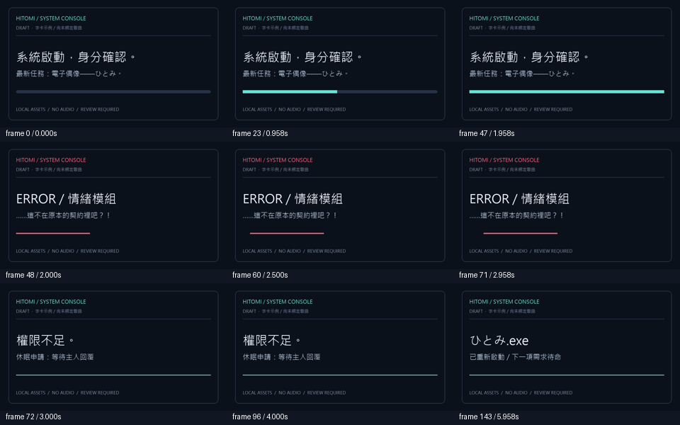

# 後製方法落地：2026-11-09

本輪把第二輪篩出的三項方法接成可用工具／交接，沒有安裝另一套生成系統。操作入口在 [後製實作](../../../skills/foyege-cinematic-direction/references/finishing-tools.md)，機讀結果為 [results.json](results.json)。

## 交付與依賴

- 原創 take_guard：Python stdlib，綁定明列 source／settings／stage 及可選音軌、參考、遮罩；SHA256 核對，不反序列化原生 stage。
- 原創 audit_visible_face：既有 NumPy／Pillow，完整 RGB8／L8 PNG 序列核對；實際合成繼續使用原生 T8 H3。
- 原創 render_system_cards：既有 Pillow 和本機提供的 CJK 字體，144 幀 DRAFT 系統字卡；時間線與字體 hash 固定，不改正式 MV。
- 兩份 JSON 範例、操作參考與回歸／可選原生校準入口隨完整技能安裝。字體、T8 程式、模型及完整試片不隨包散布。

## 已做的驗證

11 項回歸測試通過：來源／參考／stage 改動、job 時間變更、越界與重複 ID、拒絕覆蓋 receipt、真正新程序 CLI、遮罩黑／白／分數區、錯誤二次 alpha、缺幀／幾何／模式、任意時間重訪及刻意停格。這些測試驗證工具行為，不是模型品質分數。

以固定 revision 的原生 visible_face_mask.py 執行 12 幀、160×90、CPU 幾何合成素材校準；沒有臉部偵測、H3 採樣或 CUDA 初始化。完整 151800 個黑區像素沒有改變，白區及公式誤差項皆零；原候選會改動但被遮罩保護的像素共 9000。另真正執行公開 audit CLI 通過。音訊只測 sentinel 物件旁路，沒有實際 PCM 內容證據。

字卡兩次完整生成，每次 144 幀、960×540、24fps，逐幀 RGB hash 144／144 相同；第 72–119 幀的 48 幀刻意停格只有一種 hash。明列本機字體及 Pillow／Python 版本於 JSON；未散布字體。九張接觸表抽樣已查看，文字可見且沒有明顯溢出。未以抽樣冒稱完整運動人審通過。

本機另外輸出無聲 animated WebP 供看稿：重複幀合併為 74 個編碼影格，總延遲 5999ms；這是預覽量化，不是 24fps 剪輯母本。編輯使用原始 144 張 PNG 和明列 24fps，共 6 秒。



## 可重現命令

在專案根目錄，以已具備上述依賴的 Python 執行：

```powershell
python -X utf8 skills/foyege-cinematic-direction/tests/test_finishing.py
python -X utf8 skills/foyege-cinematic-direction/tests/check_native_visible_face.py --module "<reviewed T8>/h3_t8/visible_face_mask.py" --out "<new calibration directory>"
python -X utf8 skills/foyege-cinematic-direction/scripts/render_system_cards.py --config skills/foyege-cinematic-direction/assets/finishing/system_cards.example.json --font "<owned CJK font>" --out "<new output directory>"
```

原生模組來源：[T8 固定 revision](https://github.com/T8mars/comfyui-minimax-h3-audio-T8/blob/3a23f333537d9a715aad7ce79af8d9ec891d9ad8/h3_t8/visible_face_mask.py)；上游 code 不納入此公開包。使用其他版本時重做校準，不挪用本次資格。

## 尚未取得的資格

兩卡當時皆滿載，因此未啟動新 GPU 工作、不停止現有工作；本輪沒有下載模型、升級環境或啟動服務。這是小型檔案／像素檢查與 Pillow 軟體圖形，不是 GPU 生成速度測試。

尚未執行真實 H3 Full Save → 新程序 Cold Load、真人遮擋／多人身份、修臉的眼神與微表情，以及正式瞳歌曲同步。原生合成程式算式通過不等於其整張 Comfy UI 圖已驗收。已部署其他工具的殘框、字幕語意和擬音未聽審限制仍保留。
